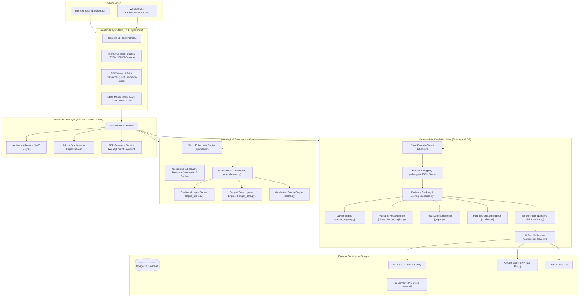
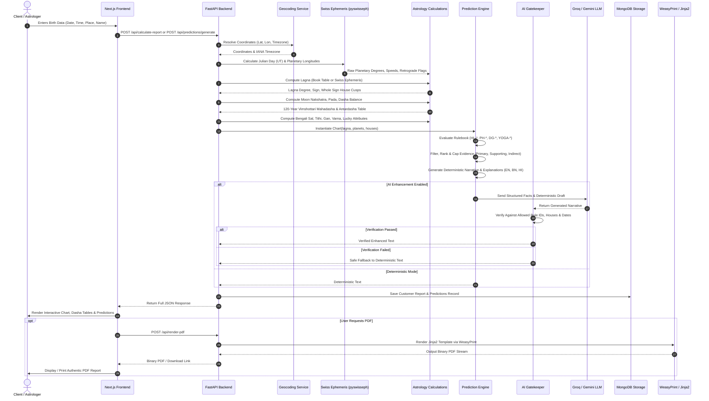
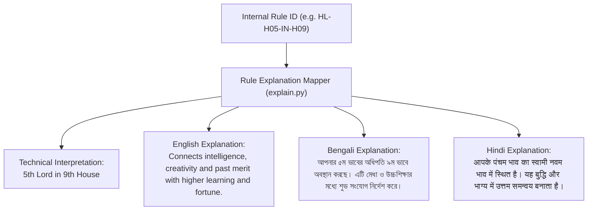
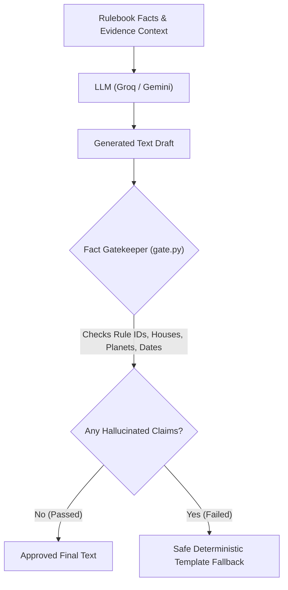

# Complete Technical Documentation: Jibon Jiggasa (জীবন জিজ্ঞাসা)
## Vedic Astrology Platform & Deterministic Parashari Prediction Engine

---

## 1. PROJECT OVERVIEW

### 1.1 What This Project Is
**Jibon Jiggasa (জীবন জিজ্ঞাসা - "Inquiry into Life")** is an enterprise-grade Vedic Astrology (Jyotish) computing and prediction software system. It combines high-precision astronomical mechanics, classical Parashari astrological principles, traditional Bengali Panjika and Koshti almanac table calculations, a rule-based deterministic prediction engine (Rulebook v2.0.0), and a controlled Large Language Model (LLM) narrative synthesizer.

The software is named after the traditional Bengali astrological consultation service founded by renowned astrologer **Sagar Ghosh (M.A., M.B.P.B.)** in West Bengal, India. The application digitizes, automates, and expands his traditional manual casting practices into a modern, dual-target desktop and web architecture.

### 1.2 What the Application Does
1. **Accurate Kundli (Birth Chart) Generation**: Computes exact planetary longitudes, house cusps, ascendant (Lagna), lunar mansions (Nakshatras), and charanam/pada for any birth date, time, and global geographic coordinate.
2. **Dual Lagna Calculation**: Offers both standard Swiss Ephemeris topocentric ascendant calculations and authentic, table-calibrated Bengali Panjika Lagna calculations based on local sunrise and Dandapala (danda-pala-vipala) time division.
3. **Traditional Koshti Almanac Generation**: Computes Bengali calendar date (Bengali Sal, Month, Day), Tithi, Karana, Yoga, Gan (Deva, Nara, Rakshasa), Varna (Brahmin, Kshatriya, Vaishya, Shudra), Yoni, and Dasha balance at birth.
4. **Vimshottari Dasha Engine**: Generates complete 120-year multi-level Dasha timelines (Mahadasha and Antardasha) utilizing pre-calibrated traditional book tables (`PREDEFINED_ANTARDASHA_DURATIONS`).
5. **Deterministic Prediction Engine (Rulebook v2.0.0)**: Matches chart conditions against an extensive Parashari rulebook covering house lord placements (`HL-*`), planets in houses (`PH-*`), planetary dignity states (`DG-*`), and auspicious/inauspicious yogas (`YOGA-*`).
6. **Career Deep-Dive Engine**: Provides comprehensive 8-point planetary impact cards, comparative scoring for Employment (চাকরি) vs. Business (ব্যবসা), career domain suggestions, and dasha-aligned timelines.
7. **Human-Readable Explanations**: Translates internal rule identifiers into clear, accessible language in English, Bengali, and Hindi, completely eliminating raw technical IDs from user reports.
8. **Controlled AI Synthesis & Review**: Integrates LLMs (Groq / Gemini / OpenRouter) strictly as auditors and synthesizers with an AST-based fact gatekeeper (`gate.py`) that eliminates ungrounded claims and halluncinations.
9. **Print-Ready PDF Generation**: Renders authentic single-page and multi-page traditional Kundli charts and comprehensive prediction reports using Jinja2 HTML templates and WeasyPrint / Playwright headless engines.

### 1.3 Who Can Use It
- **Professional Vedic Astrologers**: For instant birth chart generation, dasha timeline calculation, and report printing during client consultations.
- **Astrology Clients**: For receiving detailed, easy-to-understand career, financial, health, and relationship reports.
- **Researchers and Students of Jyotish**: For studying classical Parashari principles verified against astronomical algorithms without calculation errors.

### 1.4 High-Level Architecture
The project operates as a hybrid architecture:
- **Web Platform**: Next.js 14 (React 18, TypeScript, Tailwind CSS) frontend connecting via REST to a FastAPI (Python 3.10+) backend, backed by MongoDB.
- **Desktop Application**: An Electron 30 wrapper packaged for Windows (NSIS) and Linux, which manages local Python and Node.js child processes to provide a self-contained offline experience.

### 1.5 Differentiators from Generic Astrology Applications
Unlike generic astrology apps that rely on Western tropical zodiacs, approximate calculations, or unvetted AI text generation:
- **Strictly Sidereal with Lahiri Ayanamsha**: Implements Swiss Ephemeris (`pyswisseph`) with standard Chitra Paksha (Lahiri) Ayanamsha.
- **Authentic Bengali Panjika Calibration**: Incorporates the exact 36 traditional conditions for Gan/Varna determination and table-driven Lagna lookups from standard Bengal ephemerides.
- **Deterministic Single Source of Truth**: All predictions are derived from structured rulebook evaluations. The AI cannot invent planetary placements, house lordships, or dates; it only rephrases verified evidence.
- **Zero Raw Rule IDs in Output**: Every prediction displays full contextual explanations (involved planet, occupied house, ruled houses, traditional significance, and real-life outcomes).

---

## 2. COMPLETE PROJECT ARCHITECTURE

### 2.1 System Architecture Diagram



### 2.2 Component Roles and Responsibilities
- **Frontend (`frontend/`)**: Modern Next.js 14 App Router application delivering responsive UI for desktop and mobile screens. Features two main views: the traditional Kundli Chart Sheet view (`/`) and the comprehensive Predictions Workspace (`/predictions`).
- **Backend API (`backend/app/main.py`)**: FastAPI application managing lifecycle events, CORS middleware, API endpoint dispatching, and error interception.
- **Astrological Core (`backend/app/astrology/`)**: Executes mathematical astronomy using Swiss Ephemeris C-bindings, computes Julian Day numbers, geocentric/topocentric positions, and converts Julian/Gregorian dates to traditional Bengali Panjika dates.
- **Prediction Core (`backend/app/predictions/`)**: Implements strict Parashari logic through immutable chart models, multi-level evidence weighting, and structured template writing.
- **AI Integration (`backend/app/predictions/engine/ai_service.py` & `gate.py`)**: Provides optional natural language enhancement under strict architectural constraints.
- **Desktop Wrapper (`desktop_app/`)**: Electron application that orchestrates background processes, frees occupied network ports, launches the backend and frontend servers, and provides native desktop OS integration.

---

## 3. COMPLETE DATA FLOW

### 3.1 End-to-End Request Lifecycle



---

## 4. BIRTH DATA AND INPUT PROCESSING

### 4.1 Input Schema and Data Validation
Input data is validated via Pydantic models defined in `backend/app/schemas.py`.

```python
class BirthData(BaseModel):
    name: str = Field(..., example="Subhash Chandra")
    gender: str = Field("Male", regex="^(Male|Female|Other)$")
    date_of_birth: str = Field(..., regex=r"^\d{4}-\d{2}-\d{2}$")  # YYYY-MM-DD
    time_of_birth: str = Field(..., regex=r"^\d{2}:\d{2}(:\d{2})?$")  # HH:MM or HH:MM:SS
    place_of_birth: str = Field(..., example="Kolkata, West Bengal, India")
    latitude: Optional[float] = None
    longitude: Optional[float] = None
    timezone_offset: Optional[float] = None
    language: str = Field("bn", regex="^(bn|en|hi)$")
```

### 4.2 Location Resolution and Geocoding
Location handling is implemented in `backend/app/astrology/calculations.py` via `resolve_location(place_name)`:
1. **Local Offline Cache (`offline_places.json`)**: Pre-populated with coordinates and timezones for major Indian and Bangladeshi cities (Kolkata, Dhaka, Mumbai, Delhi, Chittagong, Siliguri, etc.) to guarantee instant, network-free resolution.
2. **Nominatim OpenStreetMap Fallback**: If a place is not in the offline cache, the system queries the OpenStreetMap Nominatim API with a polite User-Agent (`JibonJiggasa/1.0`).
3. **Timezone Determination**: Uses the `timezonefinder` library to map geographic coordinates to official IANA timezones (e.g., `Asia/Kolkata`, `Asia/Dhaka`), accurately accounting for historical Daylight Saving Time (DST) changes.

### 4.3 Traditional Bengali Date and Time Processing
In traditional Bengali Jyotish, astronomical time is reckoned in **Dandas (Ghatis)** and **Palas**:
- $1 	ext{ Solar Day} = 24 	ext{ Hours} = 60 	ext{ Dandas (দণ্ড)}$
- $1 	ext{ Danda} = 24 	ext{ Minutes} = 60 	ext{ Palas (পল)}$
- $1 	ext{ Pala} = 24 	ext{ Seconds} = 60 	ext{ Vipalas (বিপল)}$

The module `backend/app/astrology/bengali_date.py` calculates:
- **Solar Ingress (Sankranti)**: The exact moment the Sun enters a new sidereal sign using Swiss Ephemeris bisection algorithms.
- **Bengali Year (বঙ্গাব্দ / Sal)**: Calculated as $	ext{Gregorian Year} - 593$ (or $-594$ before Poila Boishakh).
- **Sunrise Reckoning**: The astrological day begins at local sunrise, not midnight. A birth occurring at 03:00 AM belongs to the previous lunar/solar day.

---

## 5. ASTRONOMICAL CALCULATION ENGINE

### 5.1 Swiss Ephemeris Integration
The application binds directly to the high-precision C-based Swiss Ephemeris via `pyswisseph` (`import swisseph as swe`).

### 5.2 Ayanamsha Configuration
Vedic astrology uses the **Sidereal Zodiac (Nirayana)**, which accounts for the precession of the equinoxes. The engine sets the Chitra Paksha (Lahiri) Ayanamsha at initialization:
```python
swe.set_sid_mode(swe.SE_SIDM_LAHIRI)
```

### 5.3 Core Astronomical Formulas

#### 1. Universal Time (UT) and Julian Day Calculation
Local civil time is converted to Universal Time (UTC) using the resolved timezone offset, then converted to the Julian Day Number:
$$	ext{Hour}_{UT} = 	ext{Hour}_{Local} + rac{	ext{Minute}}{60} + rac{	ext{Second}}{3600} - 	ext{Timezone Offset}$$
$$	ext{JD} = 	ext{swe.julday}(	ext{Year}, 	ext{Month}, 	ext{Day}, 	ext{Hour}_{UT})$$

#### 2. Sidereal Planetary Longitudes
Planetary positions are calculated with sidereal flags:
```python
flags = swe.FLG_SWIEPH | swe.FLG_SIDEREAL | swe.FLG_SPEED
result, ret_flag = swe.calc_ut(jd, planet_id, flags)
longitude = result[0]  # Ecliptic longitude in degrees [0, 360)
speed = result[3]      # Daily motion in degrees per day
```

#### 3. Retrograde Status
A planet is marked **Retrograde (Vakri / ব)** if its longitudinal speed is negative:
$$	ext{Is Retrograde} \iff 	ext{Speed} < 0$$
Rahu and Ketu are always retrograde in traditional mean node calculation.

#### 4. Combustion (Asta / অস্ত)
A planet is combust when its angular distance from the Sun falls within traditional thresholds:
$$|	heta_{	ext{planet}} - 	heta_{	ext{Sun}}| \le 	heta_{	ext{combust\_limit}}$$

| Planet | Direct Motion Limit | Retrograde Limit |
|---|---|---|
| Moon (চন্দ্র) | $12^\circ$ | N/A |
| Mars (মঙ্গল) | $17^\circ$ | $17^\circ$ |
| Mercury (বুধ) | $14^\circ$ | $12^\circ$ |
| Jupiter (বৃহস্পতি) | $11^\circ$ | $11^\circ$ |
| Venus (শুক্র) | $10^\circ$ | $8^\circ$ |
| Saturn (শনি) | $15^\circ$ | $15^\circ$ |

#### 5. Rahu and Ketu
- **Rahu (North Node)**: Calculated using `swe.MEAN_NODE` (or `swe.TRUE_NODE` if configured).
- **Ketu (South Node)**: In strict accordance with Vedic astronomy, Ketu is positioned exactly $180^\circ$ opposite to Rahu:
$$\lambda_{	ext{Ketu}} = (\lambda_{	ext{Rahu}} + 180^\circ) \pmod{360^\circ}$$

---

## 6. COMPLETE BIRTH CHART CONSTRUCTION

### 6.1 Whole Sign House System
The calculation engine strictly uses the **Whole Sign (Equal Sign)** house system, as mandated by classical Parashari Jyotish:
- The entire zodiac sign containing the Ascendant (Lagna) becomes the **1st House**.
- The next sign in zodiacal order becomes the **2nd House**, and so on.
- House cusps do not divide signs; each house coincides completely with one 30-degree zodiac sign.

```python
# Whole Sign House Derivation
house_number = ((planet_sign_index - lagna_sign_index) % 12) + 1
```

### 6.2 The 12 Zodiac Signs (Rashis)

| Index | Sanskrit / Bengali Name | English Name | Ruler Planet | Element | Quality |
|---|---|---|---|---|---|
| 0 | Mesha (মেষ) | Aries | Mars | Fire (অগ্নি) | Chara (চর / Movable) |
| 1 | Vrishabha (বৃষ) | Taurus | Venus | Earth (পৃথিবী) | Sthira (স্থির / Fixed) |
| 2 | Mithuna (মিথুন) | Gemini | Mercury | Air (বায়ু) | Dvisvabhava (দ্বিস্বভাব / Dual) |
| 3 | Karka (কর্কট) | Cancer | Moon | Water (জল) | Chara (চর / Movable) |
| 4 | Simha (সিংহ) | Leo | Sun | Fire (অগ্নি) | Sthira (স্থির / Fixed) |
| 5 | Kanya (কন্যা) | Virgo | Mercury | Earth (পৃথিবী) | Dvisvabhava (দ্বিস্বভাব / Dual) |
| 6 | Tula (তুলা) | Libra | Venus | Air (বায়ু) | Chara (চর / Movable) |
| 7 | Vrishchika (বৃশ্চিক) | Scorpio | Mars | Water (জল) | Sthira (স্থির / Fixed) |
| 8 | Dhanu (ধনু) | Sagittarius | Jupiter | Fire (অগ্নি) | Dvisvabhava (দ্বিস্বভাব / Dual) |
| 9 | Makara (মকর) | Capricorn | Saturn | Earth (পৃথিবী) | Chara (চর / Movable) |
| 10 | Kumbha (কুম্ভ) | Aquarius | Saturn | Air (বায়ু) | Sthira (স্থির / Fixed) |
| 11 | Meena (মীন) | Pisces | Jupiter | Water (জল) | Dvisvabhava (দ্বিস্বভাব / Dual) |

### 6.3 Dual Lagna Calculation Architecture
The application supports two independent Lagna calculation methodologies:
1. **Modern Swiss Ephemeris Topocentric Lagna**: Calculated using `swe.houses_ex()` with geocentric latitude and local sidereal time.
2. **Traditional Bengali Book Lagna (`calculate_book_lagna`)**: Uses pre-calculated diurnal Lagna duration tables calibrated for $22^\circ	ext{N}$ latitude (Bengal region), computing elapsed time from local sunrise in dandas and palas.

---

## 7. PLANETARY LORDSHIP SYSTEM

### 7.1 Classical Rulership Architecture
Each of the 12 signs is ruled by one of the 7 physical planets. Rahu and Ketu do not own houses in standard Parashari analysis:

```python
SIGN_LORDS = [
    "Mars",     # 0: Mesha (Aries)
    "Venus",    # 1: Vrishabha (Taurus)
    "Mercury",  # 2: Mithuna (Gemini)
    "Moon",     # 3: Karka (Cancer)
    "Sun",      # 4: Simha (Leo)
    "Mercury",  # 5: Kanya (Virgo)
    "Venus",    # 6: Tula (Libra)
    "Mars",     # 7: Vrishchika (Scorpio)
    "Jupiter",  # 8: Dhanu (Sagittarius)
    "Saturn",   # 9: Makara (Capricorn)
    "Saturn",   # 10: Kumbha (Aquarius)
    "Jupiter"   # 11: Meena (Pisces)
]
```

### 7.2 House Lord Mapping
Given a chart with an Ascendant sign $L \in \{0, 1, \dots, 11\}$:
- The sign of house $H \in \{1, 2, \dots, 12\}$ is:
$$	ext{Sign}(H) = (L + H - 1) \pmod{12}$$
- The lord of house $H$ is:
$$	ext{Lord}(H) = 	ext{SIGN\_LORDS}[	ext{Sign}(H)]$$
- Conversely, for each planet $P$, the list of houses it rules is:
$$	ext{HousesRuled}(P) = \{H \mid 	ext{Lord}(H) = P\}$$

Because Mars, Venus, Mercury, Jupiter, and Saturn each rule two signs, they rule two distinct houses in every chart. The Sun and Moon rule one house each.

---

## 8. PLANETARY ASPECTS (DRISHTI)

### 8.1 Classical Parashari Drishti Rules
In Vedic astrology, planetary aspects (Drishti) are cast from sign to sign (full house to full house):
1. **Universal 7th Aspect (সপ্তম দৃষ্টি)**: All 9 planets aspect the 7th house (opposite sign) from their placement:
$$	ext{Distance} = 7 \implies 	ext{Full Aspect}$$
2. **Special Mars Aspects (মঙ্গল দৃষ্টি)**: Mars casts full aspect on the **4th**, **7th**, and **8th** houses from its location.
3. **Special Jupiter Aspects (বৃহস্পতি দৃষ্টি)**: Jupiter casts full aspect on the **5th**, **7th**, and **9th** houses from its location (Trikona Drishti).
4. **Special Saturn Aspects (শনি দৃষ্টি)**: Saturn casts full aspect on the **3rd**, **7th**, and **10th** houses from its location.
5. **Rahu and Ketu Aspects**: Aspect the **5th**, **7th**, and **9th** houses in traditions following Parashari shadow-planet rules.

```python
def check_aspect(from_house: int, to_house: int, planet: str) -> bool:
    distance = ((to_house - from_house) % 12) + 1
    if distance == 7:
        return True
    if planet == "Mars" and distance in (4, 8):
        return True
    if planet == "Jupiter" and distance in (5, 9):
        return True
    if planet == "Saturn" and distance in (3, 10):
        return True
    if planet in ("Rahu", "Ketu") and distance in (5, 9):
        return True
    return False
```

---

## 9. PLANETARY STRENGTH AND CONDITION

### 9.1 Classical Dignity System (Dignity States)
In this implementation, planetary strength is evaluated deterministically using standard classical Parashari sign dignities:

| Planet | Exaltation Sign (Uchcha) | Deep Exaltation Degree | Debilitation Sign (Neecha) | Deep Debilitation Degree | Own Signs (Swakshetra) | Moolatrikona Sign & Degree Range |
|---|---|---|---|---|---|---|
| Sun (রবি) | Aries (মেষ) | $10^\circ$ | Libra (তুলা) | $10^\circ$ | Leo (সিংহ) | Leo ($0^\circ - 20^\circ$) |
| Moon (চন্দ্র) | Taurus (বৃষ) | $3^\circ$ | Scorpio (বৃশ্চিক) | $3^\circ$ | Cancer (কর্কট) | Taurus ($3^\circ - 30^\circ$) |
| Mars (মঙ্গল) | Capricorn (মকর) | $28^\circ$ | Cancer (কর্কট) | $28^\circ$ | Aries, Scorpio | Aries ($0^\circ - 12^\circ$) |
| Mercury (বুধ) | Virgo (কন্যা) | $15^\circ$ | Pisces (মীন) | $15^\circ$ | Gemini, Virgo | Virgo ($15^\circ - 20^\circ$) |
| Jupiter (বৃহস্পতি) | Cancer (কর্কট) | $5^\circ$ | Capricorn (মকর) | $5^\circ$ | Sagittarius, Pisces | Sagittarius ($0^\circ - 10^\circ$) |
| Venus (শুক্র) | Pisces (মীন) | $27^\circ$ | Virgo (কন্যা) | $27^\circ$ | Taurus, Libra | Libra ($0^\circ - 15^\circ$) |
| Saturn (শনি) | Libra (তুলা) | $20^\circ$ | Aries (মেষ) | $20^\circ$ | Capricorn, Aquarius | Aquarius ($0^\circ - 20^\circ$) |
| Rahu (রাহু) | Taurus / Gemini* | N/A | Scorpio / Sagittarius* | N/A | Aquarius (Co-ruler)* | Gemini / Virgo* |
| Ketu (কেতু) | Scorpio / Sagittarius* | N/A | Taurus / Gemini* | N/A | Scorpio (Co-ruler)* | Sagittarius / Pisces* |

*\*Note: In classical Jyotish, node dignities vary by commentary. The engine treats Rahu in Taurus/Gemini as exalted/favorable, and Ketu in Scorpio/Sagittarius as exalted/favorable according to Bengali astrological tradition.*

### 9.2 Planetary Relationships (Maitri Chakra)
Planets maintain natural (Naisargika) friend, neutral, and enemy relationships:
- **Sun**: Friends with Moon, Mars, Jupiter. Enemies with Venus, Saturn. Neutral with Mercury.
- **Moon**: Friends with Sun, Mercury. No natural enemies. Neutral with Mars, Jupiter, Venus, Saturn.
- **Mars**: Friends with Sun, Moon, Jupiter. Enemies with Mercury. Neutral with Venus, Saturn.
- **Mercury**: Friends with Sun, Venus. Enemies with Moon. Neutral with Mars, Jupiter, Saturn.
- **Jupiter**: Friends with Sun, Moon, Mars. Enemies with Mercury, Venus. Neutral with Saturn.
- **Venus**: Friends with Mercury, Saturn. Enemies with Sun, Moon. Neutral with Mars, Jupiter.
- **Saturn**: Friends with Mercury, Venus. Enemies with Sun, Moon, Mars. Neutral with Jupiter.

### 9.3 Combustion (Asta) and Retrograde (Vakri) Status
- **Combustion (অস্ত)**: Calculated in `calculations.py`. When a planet is within orb of the Sun, its significations become internalized or challenged, generating modifier rules (`MOD-COMBUST-*`).
- **Retrograde (বক্রী)**: Denoted by `(ব)` or `(R)`. In Parashari astrology, a retrograde benefic has enhanced strength to confer good results, while a retrograde malefic can act with unpredictable intensity.

### 9.4 Honest Technical Audit: Shadbala Status
> [!NOTE]
> **Shadbala Implementation Status**: The backend does **NOT** currently compute mathematical Shadbala (the traditional six-fold strength consisting of Sthana Bala, Dig Bala, Kala Bala, Chesta Bala, Naisargika Bala, and Drik Bala in rupas/virupas).
> Planetary strength in the prediction engine is strictly evaluated through:
> 1. Sign dignity rules (`DG-SUN-EXALTED`, `DG-SATURN-DEBILITATED`, `DG-MARS-OWN`, etc.).
> 2. Kendra / Trikona / Dusthana house placement.
> 3. Combustion and retrogradation flags.
> Any claim that this application calculates numerical Shadbala tables is false; it uses Parashari qualitative dignity.

---

## 10. NAKSHATRA AND DASHA CALCULATION

### 10.1 The 27 Nakshatras (Lunar Mansions)
The ecliptic circle ($360^\circ$) is divided into 27 equal Nakshatras of $13^\circ 20' = 800'$ each:
$$\text{Nakshatra Index} = \left\lfloor \frac{\lambda_{\text{Moon}}}{13^\circ 20'} \right\rfloor = \left\lfloor \frac{\lambda_{\text{Moon}} \times 60}{800} \right\rfloor$$
Each Nakshatra is subdivided into 4 Padas (quarters) of $3^\circ 20' = 200'$ each:
$$\text{Pada} = \left(\left\lfloor \frac{\lambda_{\text{Moon}} \times 60 \pmod{800}}{200} \right\rfloor\right) + 1$$

| Index | Nakshatra (English / Bengali) | Span (Degrees) | Lord | Gan | Varna | Yoni |
|---|---|---|---|---|---|---|
| 0 | Ashwini (অশ্বিনী) | $00^\circ 00' - 13^\circ 20'$ Aries | Ketu | Deva | Vaishya | Horse |
| 1 | Bharani (ভরণী) | $13^\circ 20' - 26^\circ 40'$ Aries | Venus | Manushya | Mleccha | Elephant |
| 2 | Krittika (কৃত্তিকা) | $26^\circ 40'$ Aries - $10^\circ 00'$ Taurus | Sun | Rakshasa | Brahmin | Sheep |
| 3 | Rohini (রোহিণী) | $10^\circ 00' - 23^\circ 20'$ Taurus | Moon | Manushya | Shudra | Serpent |
| 4 | Mrigashira (মৃগশিরা) | $23^\circ 20'$ Taurus - $06^\circ 40'$ Gemini | Mars | Deva | Servant | Serpent |
| 5 | Ardra (আর্দ্রা) | $06^\circ 40' - 20^\circ 00'$ Gemini | Rahu | Manushya | Butcher | Dog |
| 6 | Punarvasu (পুনর্বসু) | $20^\circ 00'$ Gemini - $03^\circ 20'$ Cancer | Jupiter | Deva | Vaishya | Cat |
| 7 | Pushya (পুষ্যা) | $03^\circ 20' - 16^\circ 40'$ Cancer | Saturn | Deva | Kshatriya | Sheep |
| 8 | Ashlesha (অশ্লেষা) | $16^\circ 40' - 30^\circ 00'$ Cancer | Mercury | Rakshasa | Outcaste | Cat |
| 9 | Magha (মঘা) | $00^\circ 00' - 13^\circ 20'$ Leo | Ketu | Rakshasa | Shudra | Rat |
| 10 | Purva Phalguni (পূর্ব ফাল্গুনী) | $13^\circ 20' - 26^\circ 40'$ Leo | Venus | Manushya | Brahmin | Cow |
| 11 | Uttara Phalguni (উত্তর ফাল্গুনী) | $26^\circ 40'$ Leo - $10^\circ 00'$ Virgo | Sun | Manushya | Kshatriya | Cow |
| 12 | Hasta (হস্তা) | $10^\circ 00' - 23^\circ 20'$ Virgo | Moon | Deva | Vaishya | Buffalo |
| 13 | Chitra (চিত্রা) | $23^\circ 20'$ Virgo - $06^\circ 40'$ Libra | Mars | Rakshasa | Shudra | Tiger |
| 14 | Swati (স্বাতী) | $06^\circ 40' - 20^\circ 00'$ Libra | Rahu | Deva | Butcher | Buffalo |
| 15 | Vishakha (বিশাখা) | $20^\circ 00'$ Libra - $03^\circ 20'$ Scorpio | Jupiter | Rakshasa | Outcaste | Tiger |
| 16 | Anuradha (অনুরাধা) | $03^\circ 20' - 16^\circ 40'$ Scorpio | Saturn | Deva | Brahmin | Deer |
| 17 | Jyeshtha (জ্যেষ্ঠা) | $16^\circ 40' - 30^\circ 00'$ Scorpio | Mercury | Rakshasa | Farmer | Deer |
| 18 | Mula (মূলা) | $00^\circ 00' - 13^\circ 20'$ Sagittarius | Ketu | Rakshasa | Servant | Dog |
| 19 | Purva Ashadha (পূর্বাষাঢ়া) | $13^\circ 20' - 26^\circ 40'$ Sagittarius | Venus | Manushya | Kshatriya | Monkey |
| 20 | Uttara Ashadha (উত্তরাষাঢ়া) | $26^\circ 40'$ Sagittarius - $10^\circ 00'$ Capricorn | Sun | Manushya | Vaishya | Mongoose |
| 21 | Shravana (শ্রবণা) | $10^\circ 00' - 23^\circ 20'$ Capricorn | Moon | Deva | Outcaste | Monkey |
| 22 | Dhanishta (ধনিষ্ঠা) | $23^\circ 20'$ Capricorn - $06^\circ 40'$ Aquarius | Mars | Rakshasa | Farmer | Lion |
| 23 | Shatabhisha (শতভিষা) | $06^\circ 40' - 20^\circ 00'$ Aquarius | Rahu | Rakshasa | Weaver | Horse |
| 24 | Purva Bhadrapada (পূর্ব ভাদ্রপদ) | $20^\circ 00'$ Aquarius - $03^\circ 20'$ Pisces | Jupiter | Manushya | Brahmin | Lion |
| 25 | Uttara Bhadrapada (উত্তর ভাদ্রপদ) | $03^\circ 20' - 16^\circ 40'$ Pisces | Saturn | Manushya | Kshatriya | Cow |
| 26 | Revati (রেবতী) | $16^\circ 40' - 30^\circ 00'$ Pisces | Mercury | Deva | Shudra | Elephant |

### 10.2 Vimshottari Dasha Engine

#### 1. Planetary Periods (Mahadasha Durations)
Total 120-year cycle:
- **Ketu**: 7 Years
- **Venus**: 20 Years
- **Sun**: 6 Years
- **Moon**: 10 Years
- **Mars**: 7 Years
- **Rahu**: 18 Years
- **Jupiter**: 16 Years
- **Saturn**: 19 Years
- **Mercury**: 17 Years

#### 2. Dasha Balance at Birth Formula
The portion of the birth Nakshatra remaining to be traversed by the Moon determines the balance of the ruling planet's Mahadasha:
$$\text{Arc}_{\text{traversed}} = (\lambda_{\text{Moon}} \times 60) \pmod{800}$$
$$\text{Fraction}_{\text{remaining}} = \frac{800 - \text{Arc}_{\text{traversed}}}{800} = 1 - \frac{\text{Arc}_{\text{traversed}}}{800}$$
$$\text{Balance (Years)} = \text{Fraction}_{\text{remaining}} \times \text{Mahadasha Duration}$$

#### 3. Exact Table-Driven Antardasha Durations
Rather than using floating-point approximations, the system uses the exact traditional book table (`PREDEFINED_ANTARDASHA_DURATIONS` in `calculations.py`). For example:
- In Jupiter Mahadasha (16 years total):
  - Jupiter-Jupiter: 2 years 1 month 18 days
  - Jupiter-Saturn: 2 years 6 months 12 days
  - Jupiter-Mercury: 2 years 3 months 6 days
  - Jupiter-Ketu: 11 months 6 days
  - Jupiter-Venus: 2 years 8 months 0 days
  - Jupiter-Sun: 9 months 18 days
  - Jupiter-Moon: 1 year 4 months 0 days
  - Jupiter-Mars: 11 months 6 days
  - Jupiter-Rahu: 2 years 4 months 24 days
Total = exactly 16 years.

This table-driven approach guarantees zero rounding error across all 81 Mahadasha-Antardasha combinations.

---

## 11. DIVISIONAL CHARTS (VARGA)

### 11.1 The Classical Varga System in Jyotish
Vedic astrology defines 16 divisional charts (Shodashavargas) derived from the Rashi chart (D1), including D9 (Navamsa), D10 (Dasamsa), D7 (Saptamsa), D2 (Hora), D3 (Drekkana), and D12 (Dwadasamsa).

### 11.2 Codebase Reality Audit: What Is Implemented vs. What Is Missing

| Divisional Chart | Name | Traditional Domain | Implemented in Codebase? | Used in Predictions? |
|---|---|---|---|---|
| **D1** | Rashi Chakra | Overall life, physical reality | **YES** (Core engine) | **YES** (100% of rules evaluate D1) |
| **D9** | Navamsa | Marriage, spiritual destiny, inner strength | **Partial** (Formula exists in `calculations.py`) | **NO** (Not evaluated in Rulebook v2) |
| **D10** | Dasamsa | Career, executive achievements, status | **NO** (Not calculated) | **NO** |
| **D2** | Hora | Wealth and resources | **NO** (Not calculated) | **NO** |
| **D3** | Drekkana | Siblings, courage, motivation | **NO** (Not calculated) | **NO** |
| **D7** | Saptamsa | Children, creative legacy | **NO** (Not calculated) | **NO** |
| **D12** | Dwadasamsa | Parents, ancestral heritage | **NO** (Not calculated) | **NO** |
| **D16 - D60** | Shodashavarga | Specialized fine-grained life areas | **NO** (Not calculated) | **NO** |

> [!IMPORTANT]
> **Clear Architectural Note**: The current prediction engine (Rulebook v2.0.0) is strictly built upon **D1 Rashi Whole Sign analysis**. While Navamsa sign mathematics exists in `calculations.py`, D9 placements are not currently fed into the rule matching pipeline.

---

## 12. YOGA DETECTION ENGINE

### 12.1 Classical Yogas Implemented
Yoga detection is implemented in `backend/app/predictions/engine/yogas.py` and `backend/app/astrology/calculations.py`.

#### 1. Gajakesari Yoga (গজকেশরী যোগ)
- **Condition**: Jupiter occupies a Kendra house (1st, 4th, 7th, or 10th) from the natal Moon.
- **Rule ID**: `YOGA-GAJAKESARI`
- **Effect**: Endows intelligence, emotional resilience, reputation, and public respect.

#### 2. Budhaditya Yoga (বুধাদিত্য যোগ)
- **Condition**: Sun and Mercury occupy the same sign/house without Mercury being combust within $3^\circ$.
- **Rule ID**: `YOGA-BUDHADITYA`
- **Effect**: Sharpened intellect, analytical agility, skill in calculation, administrative competence.

#### 3. Raja Yogas (রাজ যোগ)
- **Condition**: Conjunction, mutual aspect, or parivartana (sign exchange) between a Kendra lord (1st, 4th, 7th, 10th) and a Trikona lord (1st, 5th, 9th).
- **Rule IDs**: `YOGA-RAJ-01`, `YOGA-DHARMA-KARMA` (9th and 10th lords combined).
- **Effect**: Elevates professional authority, leadership stature, and career achievements.

#### 4. Dhana Yogas (ধন যোগ)
- **Condition**: Association between the lords of wealth houses (2nd and 11th) and trine houses (1st, 5th, 9th).
- **Rule ID**: `YOGA-DHANA-01`
- **Effect**: Financial prosperity, accumulation of assets, business profitability.

#### 5. Stellium / Multi-Planet Cluster Logic
When 3 or more planets occupy a single house (e.g., Jupiter + Mars + Mercury in Leo in the 9th house):
- The engine identifies this as a **Unified Planetary Cluster / Stellium** rather than treating each planet in isolation.
- It prevents repetitive identical cards and groups them into a synthesized theme highlighting concentrated focus in that life department.

---

## 13. PREDICTION ENGINE — COMPLETE EXPLANATION

### 13.1 Architecture of Rulebook v2.0.0
The prediction engine (`backend/app/predictions/engine/`) is completely deterministic. It executes a pipeline that loads rules from JSON definition files:
- `house_lord_in_house.json`: 144 house lord rules (`HL-H01-IN-H01` to `HL-H12-IN-H12`).
- `planet_in_house.json`: 108 planet-in-house rules (`PH-SUN-H01` to `PH-KETU-H12`).
- `dignity.json`: Planetary dignity rules (`DG-SUN-EXALTED`, `DG-JUPITER-OWN`, etc.).
- `yogas.json`: Auspicious and inauspicious planetary combinations.
- `forbidden_claims.json`: Medical diagnoses, fatalistic death dates, or illegal fortune-telling assertions that the engine strictly forbids.

### 13.2 Rule Matching Algorithm
```python
def evaluate_chart(chart: Chart, rulebook: RuleBook) -> List[MatchedRule]:
    matched = []
    # 1. Evaluate House Lords
    for house in range(1, 13):
        lord = chart.lord_of(house)
        occupied_house = chart.house_of(lord)
        rule_id = f"HL-H{house:02d}-IN-H{occupied_house:02d}"
        if rule := rulebook.get(rule_id):
            matched.append(rule)

    # 2. Evaluate Planet in House
    for planet in PLANETS:
        house = chart.house_of(planet)
        rule_id = f"PH-{planet.upper()}-H{house:02d}"
        if rule := rulebook.get(rule_id):
            matched.append(rule)

    # 3. Evaluate Dignity
    for planet in PLANETS:
        if dignity := chart.dignity_of(planet):
            rule_id = f"DG-{planet.upper()}-{dignity.upper()}"
            if rule := rulebook.get(rule_id):
                matched.append(rule)

    # 4. Evaluate Yogas
    matched.extend(evaluate_yogas(chart, rulebook))
    return matched
```

### 13.3 Evidence Tiers and Deduplication Caps
To prevent cognitive overload and repetitive predictions, `evidence.py` enforces strict filtering:
1. **Tier 1: Primary Evidence**:
   - The primary house of the topic (e.g., 10th house for Career).
   - The lord of the primary house.
   - Planets occupying the primary house.
   - Planets directly aspecting the primary house or its lord.
2. **Tier 2: Supporting Evidence**:
   - Related secondary houses (e.g., 2nd and 6th houses for Career).
   - Lords and occupants of secondary houses.
3. **Tier 3: Indirect Evidence**:
   - Included only when there is a concrete sambandha (conjunction, aspect, or exchange) with a primary lord.

#### Caps Enforced per Topic:
- **Maximum 3 Supportive Factors** per life topic.
- **Maximum 2 Challenging / Modifying Factors** per life topic.
- **Maximum Topic Overlap**: A single planetary placement (e.g., Venus in 7th) can appear as evidence in at most **2 topics** across the entire report.

---

## 14. LIFE-AREA PREDICTION SYSTEM

### 14.1 Canonical 8 Life Topics
Defined in `backend/app/predictions/engine/reference.py` (`CANONICAL_TOPIC_ORDER`):

| Topic ID | Bengali Name | English Name | Primary House | Supporting Houses | Natural Karakas (Significators) |
|---|---|---|---|---|---|
| `career` | কর্মজীবন ও পেশা | Career & Profession | 10th (Karma) | 6th (Service), 2nd (Earnings), 11th (Gains) | Sun, Saturn, Mercury, Jupiter |
| `finance` | অর্থ ও সম্পদ যোগ | Wealth & Finance | 2nd (Dhana) | 11th (Labha), 9th (Bhagya), 5th (Purva Punya) | Jupiter, Venus, Mercury |
| `marriage` | দাম্পত্য ও সম্পর্ক | Marriage & Partnerships | 7th (Kalatra) | 2nd (Family), 8th (Longevity), 12th (Intimacy) | Venus (all/males), Jupiter (females) |
| `health` | স্বাস্থ্য ও জীবনীশক্তি | Health & Vitality | 1st (Tanu/Lagna) | 6th (Roga), 8th (Randhra), 12th (Hospitalization) | Sun, Moon, Mars |
| `education` | শিক্ষা ও বিদ্যাবত্তা | Education & Intellect | 5th (Buddhi) | 4th (Vidya), 9th (Higher Knowledge) | Mercury, Jupiter |
| `spirituality` | আধ্যাত্মিকতা ও ধর্মভাব | Spirituality & Dharma | 9th (Dharma) | 12th (Moksha), 5th (Devotion), 8th (Occult) | Jupiter, Ketu, Saturn |
| `home` | গৃহ ও পারিবারিক পরিবেশ | Home & Family Environment | 4th (Sukha/Matru) | 2nd (Kula/Family lineage) | Moon, Venus, Mars (property) |
| `travel` | ভ্রমণ ও দূরসংযোগ | Travel & Foreign Connection | 9th (Long journeys) | 12th (Foreign lands), 3rd (Short trips), 7th | Moon, Rahu, Saturn |

---

## 15. CAREER PREDICTION SYSTEM — DEEP DIVE

### 15.1 The 8-Point Career Placement Analysis
Implemented in `backend/app/predictions/engine/career_engine.py`. For every planet influencing the career axis (10th house, 10th lord, 6th, 2nd), the engine constructs a structured 8-point card:
1. **Planet Involved**: Identifies the celestial body (e.g., Mercury / বুধ).
2. **House Occupied**: Specifies the Whole Sign house location (e.g., 9th House / নবম ভাব).
3. **Houses Ruled**: Explicitly states all houses ruled by the planet in this specific Lagna.
4. **House Signification**: Describes the domain represented by those ruled houses.
5. **Traditional Indication**: Classical astrological interpretation of this placement.
6. **Practical Career Outcomes**: Realistic modern professions matching the energy (e.g., analytical roles, data management, advisory).
7. **Potential Challenges**: Constructive cautionary notes (e.g., over-thinking, contract ambiguities).
8. **Modifying Chart Factors**: Other influences that strengthen or temper the result (e.g., conjunction with Jupiter, aspects from Saturn).

### 15.2 Employment (চাকরি) vs. Business (ব্যবসা) Evaluation
The engine calculates an empirical suitability score comparing Service vs. Self-Employment/Enterprise:
- **Employment Indicators**: Strong 6th house (Upachaya/service), Saturn dominance, Sun in Kendra (public sector/government), disciplined 10th house.
- **Business Indicators**: Strong 7th house (partnerships/trade), 3rd house (enterprise/initiative), 11th house (commercial gains), Mercury/Venus dominance, active Dhana yogas.
- **Comparative Output**: Renders a clear breakdown comparing both modes without rigid stereotyping.

### 15.3 Suggested Career Domains
Maps dominant planetary influences to modern industries:
- **Sun / Mars**: Public administration, defense, governance, civil engineering, surgery, executive leadership.
- **Mercury / Jupiter**: Finance, banking, education, software engineering, law, publishing, corporate consultancy.
- **Venus / Moon**: Creative arts, design, media, public relations, hospitality, healthcare, diplomacy.
- **Saturn / Rahu**: Industrial production, logistics, infrastructure, emerging technologies, research and development.

---

## 16. WEALTH AND FINANCIAL PREDICTION

### 16.1 Astrological Evaluation of Wealth
Financial analysis centers on the interaction between **Dhana Bhavas** (2nd and 11th) and **Trikonas** (1st, 5th, 9th):
- **2nd House (Dhana Bhava)**: Accumulated assets, liquid capital, bank balance, family wealth.
- **11th House (Labha Bhava)**: Inflow of revenue, recurring gains, network expansion, fulfillment of desires.
- **5th House (Purva Punya)**: Speculative gains, intellectual investments, past karma dividends.
- **9th House (Bhagya Bhava)**: General fortune, father's support, prosperity through ethical conduct.
- **12th House (Vyaya Bhava)**: Expenditure patterns, capital outflow, foreign investments.

### 16.2 Dhana Yoga Scoring
When lords of the 2nd, 11th, 5th, and 9th exchange houses, conjunct, or cast mutual aspects, the system scores the financial strength as **High**, **Moderate**, or **Developing**:
$$\text{Financial Strength} = \sum (\text{Dhana Yoga Points}) + \text{Dignity}(\text{Lord}_2) + \text{Dignity}(\text{Lord}_{11}) - \text{Malefic Afflictions}$$

---

## 17. RELATIONSHIP AND MARRIAGE PREDICTION

### 17.1 Astrological Factors for Partnerships
Relationship analysis evaluates the **Kalatra** axis and supporting houses:
- **7th House (Kalatra Bhava)**: Primary house of marriage, legal unions, lifelong partnerships, and social contracts.
- **7th House Lord**: Placement, conjunctions, and aspects received by the ruler of the 7th sign from Lagna.
- **Natural Karakas (Significators)**:
  - **Venus (শুক্র)**: Primary significator of romance, harmony, conjugal happiness, and partner qualities for all charts.
  - **Jupiter (বৃহস্পতি)**: Secondary significator for female charts in classical Parashari framing, representing the husband and ethical anchor.
- **2nd House (Kutumba Bhava)**: Harmony in extended family and marital household.
- **8th House (Mangalya / Randhra)**: Marital longevity and mutual financial trust.
- **12th House (Shayana Sukha)**: Intimacy, private life, and domestic seclusion.

### 17.2 Delay and Growth Indicators
- **Saturn Influence on 7th House or Lord**: Indicates mature relationships, emotional sobriety, and marriage often stabilizing after age 28-30.
- **Mars (Kuja) Influence**: Evaluated for assertiveness, boundary setting, and passion. The engine frames Kuja aspects constructivley as requiring open dialogue and shared physical or sporting outlets rather than fatalistic condemnation.
- **Rahu/Ketu on 1/7 Axis**: Indicates unconventional, cross-cultural, or highly transformative relationship dynamics.

---

## 18. TIMING AND EVENT PREDICTION

### 18.1 Vimshottari Mahadasha & Antardasha Timing Engine
Implemented in `backend/app/predictions/engine/dasha.py`. The timing engine connects active planetary periods to natal promises:
1. **Active Period Identification**: Given the current date $T$, the engine determines the active Mahadasha (MD) and Antardasha (AD) lords by querying the calculated dasha timeline:
$$T \in [\text{Start}_{\text{MD}}, \text{End}_{\text{MD}}] \quad \text{and} \quad T \in [\text{Start}_{\text{AD}}, \text{End}_{\text{AD}}]$$
2. **Natal Role of Dasha Lords**:
   - Houses ruled by the Mahadasha lord (broad life theme).
   - House occupied by the Antardasha lord (specific arena of manifestation).
   - Relationship between MD and AD lords (Sambandha, Kendra, Trikona, or 6/8 Shadashtaka).
3. **Timeline Card Generation**: Produces a contextualized dasha window explanation describing which life departments are stimulated during the active window, avoiding unrealistic date promises while highlighting favorable timing for initiative.

### 18.2 Transit (Gochara) Engine Reality Audit
> [!NOTE]
> **Transit (Gochara) Status**: The automated prediction pipeline does **NOT** currently compute dynamic real-time transits (e.g., current Saturn Sade Sati transits, Jupiter 1-year transit, or Rahu-Ketu 18-month transit).
> Event timing in the present version is **exclusively driven by Vimshottari Mahadasha and Antardasha** correlated with natal house lordships.

---

## 19. REPORT GENERATION SYSTEM

### 19.1 Dual Report Paradigms
The software delivers two distinct reporting modes:


#### 1. Traditional Single-Page Kundli Sheet (`/`)
- Replicates the classic heritage format of Astrologer Sagar Ghosh's printed consultations.
- Visual elements: Pink/red ornamental border, traditional Bengali typography, North Indian diamond Rashi Chakra, full planetary degree table, 120-year Vimshottari Dasha table, Bengali Sal, Tithi, Gan, Varna, and lucky attributes.
- Rendered via `backend/app/pdf/generate_pdf.py`.

#### 2. Comprehensive Multi-Page Predictions Report (`/predictions`)
- Modern, multi-page professional report covering all 8 life domains.
- Contains executive summary, career deep-dive with 8-point cards, employment vs. business comparison, dasha timeline, and human-readable astrological evidence accordions.

### 19.2 Rendering Architecture & Fallbacks
- **Primary Backend Renderer**: **WeasyPrint** (Python library converting HTML5 + CSS Paged Media to native vector PDF).
- **Secondary Headless Renderer**: **Playwright** (Chromium headless instance used if WeasyPrint encounters complex SVG or Canvas layouts).
- **Client-Side Fallback**: The Next.js frontend includes `jsPDF` and `html-to-image` in `frontend/components/PdfViewer.tsx` to allow emergency client-side PDF downloads if the backend PDF renderer is unreachable.

---

## 20. PREDICTION EXPLANATION AND EVIDENCE SYSTEM

### 20.1 Elimination of Technical Rule IDs (Section 20 Implementation)
In earlier versions, reports displayed raw rulebook identifiers such as:
- `HL-H05-IN-H09`
- `PH-KETU-H11`
- `DG-SATURN-OWN`

These internal IDs have been completely eradicated from user-facing views through the mapping system implemented in `backend/app/predictions/engine/explain.py` and `reference.py`.

### 20.2 Rule Explanation Architecture



### 20.3 Structured Explanation Schema
Every astrological explanation provides:
1. **Involved Planet**: Name and nature of the planet.
2. **Occupied House**: Where the planet is positioned.
3. **Ruled Houses**: What areas of life the planet governs.
4. **Natural Significations**: Core attributes of the houses involved.
5. **Practical Manifestation**: Realistic daily life and career outcomes.
6. **Constructive Growth Advice**: Balanced recommendations for self-development.

---

## 21. AI / GROQ / CHATBOT INTEGRATION

### 21.1 Multi-Provider AI Architecture
Implemented in `backend/app/predictions/engine/ai_service.py`:
- **Groq API**: Default ultra-fast provider utilizing `llama-3.3-70b-versatile`.
- **Google Gemini API**: Configurable fallback utilizing `gemini-1.5-flash`.
- **OpenRouter API**: Universal gateway supporting multiple open-source and proprietary models.

### 21.2 The Fact-Checking Gatekeeper (`gate.py`)
To prevent the hallucinations common in generative LLMs, the system routes all AI text through a strict verification filter:



#### Rules Enforced by `gate.py`:
1. **Planet Whitelist**: The text may only mention planets that actually appear in the verified evidence for that topic.
2. **House Whitelist**: The text cannot reference houses not related to the topic's primary or supporting houses.
3. **Forbidden Claims Filter**: Scans against `forbidden_claims.json` to block medical diagnoses, lifespan predictions, or catastrophic fatalism.
4. **Fallback Mechanism**: If the AI output violates any constraint, it is discarded immediately and replaced by the pre-computed deterministic narrative from `writer.py`.

### 21.3 In-Memory RAG Store (`rag_store.py`)
The system maintains an in-memory retrieval store index of traditional astrological reference principles from `new.txt`, injecting relevant classical shlokas and definitions into the system prompt for deeper context.

---

## 22. API DOCUMENTATION

### 22.1 Complete REST Endpoints Specification

| Method | Endpoint | Router File | Authentication | Description | Request Body / Parameters | Response Schema |
|---|---|---|---|---|---|---|
| `POST` | `/api/generate-chart` | `report.py` | Public | Generates raw astrological chart | `BirthData` (Date, Time, Place) | Chart JSON (planets, lagna, houses) |
| `POST` | `/api/calculate-report` | `pdf.py` | Public | Computes full chart, dasha & report | `BirthData` | Full Report JSON (with dasha & Koshti) |
| `POST` | `/api/render-pdf` | `pdf.py` | Public | Renders traditional or prediction PDF | `ReportData` | Binary PDF (`application/pdf`) |
| `GET` | `/api/download-pdf/{pdf_id}` | `pdf.py` | Public | Downloads generated PDF by ID | `pdf_id: str` | Binary PDF file stream |
| `POST` | `/api/predictions/generate` | `predictions.py` | Public | Runs complete prediction pipeline | `PredictionRequest` | Complete Predictions JSON |
| `POST` | `/api/predictions/regenerate-section` | `predictions.py` | Public | Re-evaluates single life topic | `{chart_hash, topic_id, language}` | Updated Topic Section JSON |
| `POST` | `/api/predictions/edit-section` | `predictions.py` | Authenticated | Astrologer manual edit of section | `{report_id, topic_id, custom_text}` | Success confirmation |
| `GET` | `/api/predictions/ai-config` | `predictions.py` | Public | Returns active AI provider & models | None | `{provider, model, enabled}` |
| `POST` | `/api/places/search` | `report.py` | Public | Geocoding search for city/town | `query: str` | `List[PlaceResult]` (lat, lon, name) |
| `POST` | `/api/auth/login` | `auth.py` | Public | Astrologer admin authentication | `{username, password}` | `{access_token, token_type}` |
| `POST` | `/api/auth/change-password` | `auth.py` | Authenticated | Updates admin password | `{old_password, new_password}` | `{status: "success"}` |
| `GET` | `/api/admin/dashboard` | `admin.py` | Authenticated | Admin statistics & report count | None | `{total_reports, recent_activity}` |
| `GET` | `/api/admin/reports` | `admin.py` | Authenticated | Paginated list of saved reports | `skip: int, limit: int` | `List[CustomerReport]` |
| `GET` | `/api/admin/reports/search` | `admin.py` | Authenticated | Search reports by client name | `q: str` | `List[CustomerReport]` |
| `GET` | `/api/admin/reports/{report_id}` | `admin.py` | Authenticated | Fetch specific client report | `report_id: str` | Full Report Record JSON |

---

## 23. DATABASE AND DATA STRUCTURES

### 23.1 MongoDB Configuration and Collections
Implemented in `backend/app/db/__init__.py`. Uses `pymongo` with a resilient 2000ms connection timeout:
- If MongoDB is running: Full persistent storage for users, clients, and generated reports.
- If MongoDB is offline: System automatically falls back to in-memory mode, logging a warning while continuing to serve calculations and predictions seamlessly.

### 23.2 Database Collections
1. **`users` Collection**:
   - `username`: String (Unique)
   - `hashed_password`: String (Bcrypt hash)
   - `role`: String (`admin` / `astrologer`)
   - `created_at`: ISODate
2. **`customer_reports` Collection**:
   - `_id`: ObjectId
   - `client_name`: String
   - `date_of_birth`: String (YYYY-MM-DD)
   - `time_of_birth`: String (HH:MM)
   - `place_of_birth`: String
   - `chart_data`: Object (planets, lagna, houses, nakshatra, dasha)
   - `predictions`: Object (all 8 life areas, evidence, themes, challenges)
   - `pdf_url`: String (Local path or Cloudinary URL)
   - `created_at`: ISODate

### 23.3 In-Memory Prediction Caching
To ensure instant sub-millisecond responses on repeated queries, `backend/app/predictions/service.py` maintains an in-memory cache:
$$\text{CacheKey} = \text{SHA256}(\text{BirthData} + \text{RulesetVersion})$$

---

## 24. MULTILINGUAL SYSTEM

### 24.1 Tri-Lingual Localization Architecture
The software natively supports three languages:
- **Bengali (`bn`)**: Primary language of the traditional practice.
- **English (`en`)**: International consultations and modern clients.
- **Hindi (`hi`)**: Pan-Indian client consultations.

### 24.2 Bengali Digit Conversion
The utility function `to_bengali_digits(number_str)` maps standard ASCII digits to Eastern Nagari (Bengali) numerals:

```python
BN_DIGITS = {"0": "০", "1": "১", "2": "২", "3": "৩", "4": "৪",
             "5": "৫", "6": "৬", "7": "৭", "8": "৮", "9": "৯"}

def to_bengali_digits(val: Any) -> str:
    return "".join(BN_DIGITS.get(ch, ch) for ch in str(val))
```

### 24.3 Language Harmonization: Single Source of Truth
Historically, language translations were prone to drift where English and Bengali reports evaluated different evidence. In the current engine:
1. **Language-Agnostic Evidence Generation**: A single structured evidence object is computed per chart (`evidence.py`).
2. **Presentation-Layer Rendering**: The narrative writer (`writer.py`) and explanation mapper (`explain.py`) render the exact same underlying facts into the selected language, guaranteeing 100% semantic parity across Bengali, English, and Hindi.

---

## 25. SECURITY AND PRIVACY

### 25.1 Authentication and Authorization
- **JWT (JSON Web Tokens)**: Administrative and editing endpoints require a signed Bearer token issued upon valid login at `/api/auth/login`. Tokens are signed using the `HS256` algorithm and validated via `backend/app/auth_middleware.py`.
- **Password Hashing**: User passwords are stored using salted `bcrypt` hashes (`passlib.context.CryptContext(schemes=["bcrypt"])`), ensuring resistance to dictionary and rainbow-table attacks.

### 25.2 Data Privacy and Offline Security
- **Local Standalone Operation**: The desktop application (packaged with Electron and PyInstaller) allows complete offline execution. Client birth details, names, and horoscopes need never leave the local machine, preventing sensitive personal data exposure.
- **Input Sanitization**: Pydantic models strictly validate all incoming data types, character formats, coordinate bounds, and date/time structures before parameters reach the computational core.

---

## 26. PROJECT FILE DIRECTORY GUIDE

### 26.1 Complete Directory Walkthrough

```
College_Project/
├── PROJECT_DOCUMENTATION.md          # Complete Technical Documentation (This Document)
├── README.md                         # Quick-start instructions and project summary
├── Complete_Jyotish_Prediction_...   # Reference document for prediction rules
├── new.txt                           # Astrological knowledge base source file for RAG
├── package.json                      # Workspace root scripts and dependency manifest
│
├── backend/                          # FastAPI Python Backend Application
│   ├── run_server.py                 # Backend launch entrypoint script
│   ├── requirements.txt              # Python package dependencies
│   ├── Dockerfile                    # Containerization instructions
│   ├── app/
│   │   ├── main.py                   # FastAPI app instance, CORS & router registrations
│   │   ├── auth_middleware.py        # JWT Bearer token validation middleware
│   │   ├── auth_models.py            # User credentials and token schemas
│   │   ├── schemas.py                # Pydantic input/output validation models
│   │   ├── api/routes/
│   │   │   ├── report.py             # Chart calculation, geocoding & place search APIs
│   │   │   ├── predictions.py        # Prediction generation & regeneration APIs
│   │   │   ├── pdf.py                # PDF rendering, calculation & download APIs
│   │   │   ├── auth.py               # Astrologer login and authentication APIs
│   │   │   └── admin.py              # Report archiving, search & dashboard APIs
│   │   ├── astrology/
│   │   │   ├── calculations.py       # Core Swiss Ephemeris & astronomical algorithms
│   │   │   ├── bengali_date.py       # Solar ingress & traditional Bengali calendar
│   │   │   ├── lagna_table.py        # Pre-calculated traditional Lagna lookups
│   │   │   └── data/                 # Offline geocoding databases (places, cities)
│   │   ├── db/
│   │   │   └── __init__.py           # MongoDB connection, user & report persistence
│   │   ├── pdf/
│   │   │   ├── generate_pdf.py       # WeasyPrint / Playwright PDF rendering engine
│   │   │   └── templates/            # Jinja2 HTML/CSS templates for printed sheets
│   │   ├── predictions/
│   │   │   ├── service.py            # Prediction orchestration service & caching
│   │   │   ├── config/ruleset.json   # Prediction engine configuration & versioning
│   │   │   ├── rules/                # Parashari Rulebook JSON files
│   │   │   │   ├── house_lord_in_house.json  # 144 House lord rules
│   │   │   │   ├── planet_in_house.json      # 108 Planet in house rules
│   │   │   │   ├── dignity.json              # Dignity rules (exalted/debilitated/own)
│   │   │   │   ├── yogas.json                # Special yogas (Raja, Dhana, Gajakesari)
│   │   │   │   └── forbidden_claims.json     # Blacklisted fortune-telling claims
│   │   │   └── engine/
│   │   │       ├── pipeline.py       # Master prediction execution pipeline
│   │   │       ├── chart.py          # Immutable Chart domain model & aspect math
│   │   │       ├── rules.py          # Rulebook loader and evaluation logic
│   │   │       ├── evidence.py       # Evidence scoring, ranking & deduplication
│   │   │       ├── writer.py         # Deterministic text generator for topics
│   │   │       ├── career_engine.py  # 8-point career cards & business/job score
│   │   │       ├── planet_house_engine.py # Planet in house interpretation cards
│   │   │       ├── yogas.py          # Astrological yoga detection algorithms
│   │   │       ├── dasha.py          # Vimshottari Mahadasha/Antardasha timing
│   │   │       ├── explain.py        # Technical ID to natural language translation
│   │   │       ├── reference.py      # Canonical constants, dictionaries & mappings
│   │   │       ├── ai_service.py     # Groq, Gemini & OpenRouter LLM clients
│   │   │       └── gate.py           # Fact-checking gatekeeper against hallucinations
│   │   └── rag/
│   │       └── rag_store.py          # In-memory document search over new.txt
│   └── tests/                        # Comprehensive Pytest test suites
│       ├── test_antardasha.py        # Validates exact Antardasha duration tables
│       ├── test_lagna_timeline.py    # Tests Ascendant and timeline transitions
│       ├── test_audit_regression.py  # Validates chart generation outputs
│       ├── test_prediction_engine_regression.py # Regression test for prediction parity
│       └── test_worldwide_location.py# Validates international geocoding and DST
│
├── frontend/                         # Next.js 14 TypeScript Web Client
│   ├── app/
│   │   ├── layout.tsx                # Root layout with fonts & metadata
│   │   ├── page.tsx                  # Traditional Chart Sheet & interactive Kundli
│   │   ├── predictions/page.tsx      # Comprehensive Predictions Workspace
│   │   ├── login/page.tsx            # Astrologer admin login page
│   │   ├── admin/page.tsx            # Admin dashboard and client report records
│   │   ├── report/page.tsx           # Legacy report view
│   │   └── create-report/page.tsx    # Customer onboarding form
│   ├── components/
│   │   ├── AIAssistant.tsx           # Interactive AI Chatbot drawer
│   │   ├── InteractiveChart.tsx      # SVG/Canvas North Indian Rashi Chakra
│   │   ├── PdfViewer.tsx             # PDF viewer and print dispatcher
│   │   └── ReportForm.tsx            # Birth input form with geocoding autocompletion
│   ├── services/
│   │   └── api.ts                    # Axios/Fetch client connecting to FastAPI
│   └── types/
│       ├── predictions.ts            # TypeScript interfaces for prediction data
│       └── report.ts                 # TypeScript interfaces for astrological data
│
└── desktop_app/                      # Electron Desktop Packaging Shell
    ├── main.js                       # Electron main process (spawns servers & ports)
    ├── loading.html                  # Splash screen during backend initialization
    └── package.json                  # Electron build and NSIS installer configuration
```

---

## 27. ACTUAL CALCULATION EXAMPLES

### 27.1 End-to-End Worked Chart Calculation
To demonstrate the exact mathematical formulas, consider the following reference test chart:
- **Date of Birth**: December 26, 2008
- **Time of Birth**: 12:42:00 Local Civil Time (IST)
- **Place of Birth**: Kolkata, West Bengal, India ($22^\circ 34' \text{N}, 88^\circ 22' \text{E}$)
- **Timezone**: UTC $+05:30$

#### 1. Universal Time and Julian Day
$$\text{Hour}_{UT} = 12.70 - 5.50 = 7.20 \text{ hours} \implies \text{07:12:00 UTC}$$
$$\text{JD} = \text{swe.julday}(2008, 12, 26, 7.20) = 2454826.80$$

#### 2. Ascendant (Lagna) Calculation
At Kolkata coordinates with Lahiri Ayanamsha ($\approx 23^\circ 59'$ in 2008):
- **Lagna Longitude**: $\approx 244^\circ 15'$
- **Sign**: $\lfloor 244.25^\circ / 30^\circ \rfloor = 8 \implies \text{Dhanu (Sagittarius / ধনু)}$
- **Lagna Lord**: Jupiter (বৃহস্পতি)

#### 3. Whole Sign House Assignment
Since Lagna is Sagittarius (Sign 8):
- House 1 = Sagittarius (Dhanu)
- House 5 = Aries (Mesha) [Occupant: Rahu]
- House 7 = Gemini (Mithuna) [Occupants: Moon, Venus, Saturn]
- House 8 = Cancer (Karka) [Occupant: Sun]
- House 9 = Leo (Simha) [Occupants: Mercury, Jupiter, Mars]
- House 11 = Libra (Tula) [Occupant: Ketu]

#### 4. Moon Nakshatra & Dasha Balance
- **Moon Longitude**: $86^\circ 53'$ (Gemini / Mithuna)
- **Nakshatra**: $\lfloor 86.883^\circ / 13.333^\circ \rfloor = 6 \implies \text{Punarvasu (পুনর্বসু)}$
- **Nakshatra Lord**: Jupiter (16 Years Mahadasha)
- **Nakshatra Span**: $80^\circ 00' - 93^\circ 20'$
- **Moon Traversed**: $86^\circ 53' - 80^\circ 00' = 6^\circ 53' = 413'$
- **Remaining Fraction**: $\frac{800 - 413}{800} = \frac{387}{800} = 0.48375$
- **Jupiter Dasha Balance at Birth**:
$$0.48375 \times 16 \text{ years} = 7 \text{ years, } 8 \text{ months, } 23 \text{ days}$$

#### 5. Rulebook Matching
- **Mercury, Jupiter, Mars in Leo (9th House)**:
  - 9th House Lord (Sun) in 8th house $\implies$ `HL-H09-IN-H08`
  - 1st House Lord (Jupiter) in 9th house $\implies$ `HL-H01-IN-H09` (Primary support for higher wisdom)
  - 5th House Lord (Mars) in 9th house $\implies$ `HL-H05-IN-H09` (Trikona-in-Trikona auspicious yoga)
  - 10th House Lord (Mercury) in 9th house $\implies$ `HL-H10-IN-H09` (Dharma-Karmadhipati Yoga)
  - **Unified Cluster**: Evaluated as a single 3-planet stellium in the 9th house combining intellect (Mercury), fortune/expansion (Jupiter), and dynamic initiative (Mars).

---

## 28. TESTING AND VALIDATION

### 28.1 The Test Suite (`backend/tests/`)
The software maintains automated regression test suites executed via Pytest:
1. **`test_antardasha.py`**:
   - Validates that the pre-calibrated table `PREDEFINED_ANTARDASHA_DURATIONS` matches the classical 120-year cycle to the exact day.
   - Tests transition boundaries for all 81 Mahadasha-Antardasha combinations.
2. **`test_lagna_timeline.py`**:
   - Asserts that local sunrise calculations and dandapala conversions produce exact Ascendants across diverse Indian and international latitudes.
3. **`test_audit_regression.py`**:
   - Runs full chart generation against historical benchmark horoscopes to ensure that code changes never alter calculated planetary longitudes or house cusps.
4. **`test_prediction_engine_regression.py`**:
   - Verifies the **Single Source of Truth**: confirms that identical evidence objects are generated regardless of output language (EN/BN/HI).
   - Verifies that rule evidence caps (maximum 3 supportive, 2 challenging) and cluster grouping algorithms function as designed.
5. **`test_worldwide_location.py`**:
   - Tests international city geocoding, Southern Hemisphere chart casting, and negative/positive timezone shifts.

### 28.2 Running the Test Suite
```bash
# Activate backend virtual environment
source backend/venv/bin/activate

# Execute all tests with verbose output
pytest -v backend/tests/
```

---

## 29. KNOWN LIMITATIONS AND TECHNICAL DEBT

### 29.1 Candid Architectural Audit
To ensure complete transparency, this section documents all known technical limitations, omissions, and areas of technical debt in the current codebase:

1. **Absence of Higher Divisional Charts in Predictions**:
   - While formulas for D9 (Navamsa) calculation exist in `calculations.py`, neither D9 nor higher Vargas (D10 Dasamsa, D7, D2, etc.) are evaluated by the Rulebook v2.0.0 engine. Predictions are derived exclusively from the D1 Rashi chart.
2. **No Mathematical Shadbala Calculation**:
   - Six-fold numerical strength (Sthana, Dig, Kala, Chesta, Naisargika, Drik bala) is not implemented. Planetary strength is approximated through qualitative sign dignity (exaltation, own, debilitation) and house placement.
3. **Absence of Real-Time Planetary Transit (Gochara) Engine**:
   - Daily, monthly, or annual planetary transits are not tracked in the automated prediction pipeline. Event timing is purely natal Vimshottari Mahadasha/Antardasha driven.
4. **Network Dependency for Remote Geocoding**:
   - The offline location database (`offline_places.json`) contains major regional cities. If a user enters an obscure rural location not in the cache, the backend requires active internet access to reach the OpenStreetMap Nominatim API.
5. **Graceful Degradation of MongoDB**:
   - If MongoDB is not active on `localhost:27017`, the backend logs a warning and stores reports in volatile memory only. Reports created during a database outage are not persisted permanently across restarts.

---

## 30. HOW I CAN UNDERSTAND AND MAINTAIN THIS PROJECT

### 30.1 Step-by-Step Developer Onboarding Guide (18 Steps)

Follow these 18 logical steps to master, debug, and maintain this codebase:

1. **Inspect `backend/requirements.txt` and `package.json`**: Understand all external dependencies (FastAPI, pyswisseph, Pydantic, WeasyPrint, Next.js, Electron).
2. **Review `backend/app/astrology/calculations.py`**: Study the Swiss Ephemeris wrapper and observe how `swe.calc_ut()` converts UTC timestamps to sidereal longitudes.
3. **Trace `resolve_location()`**: Understand how offline location dictionaries and Nominatim geocoding map place names to coordinates and IANA timezones.
4. **Examine `calculate_book_lagna()` and `lagna_table.py`**: Understand how traditional Bengali Panjika Lagna tables calculate Dandapala from sunrise.
5. **Understand `_calc_nakshatra()` and `_calc_dasha()`**: Review the 27 Nakshatras, Moon arc traversal, and how the Vimshottari balance of birth is calculated.
6. **Examine `PREDEFINED_ANTARDASHA_DURATIONS`**: Verify how traditional table-driven dasha periods prevent rounding errors.
7. **Inspect `backend/app/predictions/engine/chart.py`**: See how the immutable `Chart` class computes Whole Sign house cusps, planetary rulerships (`lorded()`), and Parashari aspects (`aspects()`).
8. **Explore `backend/app/predictions/rules/` JSON Files**: Review the 144 house lord rules, 108 planet-in-house rules, and dignity definitions.
9. **Trace `RuleBook.evaluate()` in `rules.py`**: Understand how incoming chart conditions are matched against rule IDs.
10. **Study `evidence.py`**: Observe how matched rules are tiered (Primary, Supporting, Indirect), capped (max 3 supportive, 2 challenging), and deduplicated.
11. **Review `career_engine.py`**: Understand the 8-point career cards and the mathematical comparison between Employment (Service) and Business.
12. **Study `explain.py`**: Trace how raw rule IDs (`HL-H05-IN-H09`) are translated into human-readable text across English, Bengali, and Hindi.
13. **Examine `gate.py` and `ai_service.py`**: Review the fact-checking gatekeeper that validates LLM-generated output against allowed rule IDs, houses, and dates.
14. **Inspect `backend/app/pdf/generate_pdf.py` and Jinja2 Templates**: Understand how HTML/CSS templates are rendered into print-ready PDFs with WeasyPrint.
15. **Trace the Next.js Frontend (`frontend/app/`)**: Understand how `page.tsx` renders the traditional Kundli sheet and `predictions/page.tsx` renders the modern prediction workspace.
16. **Review `desktop_app/main.js`**: Understand how Electron checks and frees ports (8000 and 3000), launches child processes, and manages the desktop window.
17. **Run the Automated Pytest Suite**: Execute `pytest -v backend/tests/` to verify that all regression checks and calculation baselines pass.
18. **Perform a Safe Code Modification**: When adding a new astrological rule, always add it to the corresponding JSON file in `backend/app/predictions/rules/` and register its human-readable translation in `explain.py`. Never bypass `gate.py` or modify raw chart calculations without updating regression tests.

---

## 31. FINAL PROJECT SUMMARY

### 31.1 Executive Summary
**Jibon Jiggasa (জীবন জিজ্ঞাসা)** represents a modern bridge between traditional, centuries-old Bengali Vedic astrology and cutting-edge software engineering. By marrying the astronomical precision of the C-based Swiss Ephemeris with the authentic table-driven calibrations of traditional Panjika ephemerides, the platform guarantees that birth chart casting is mathematically accurate.

By implementing an immutable, deterministic Parashari prediction engine (Rulebook v2.0.0) with an automated fact gatekeeper, the system avoids the vague, contradictory, or hallucinatory outputs typical of generic AI-based astrology tools. Every prediction presented to the user is grounded in classical shlokas, mapped to an 8-domain structured ontology, and articulated in clear, dignified language across Bengali, English, and Hindi.

### 31.2 Strategic Roadmap for Future Development
- **Phase 1: Divisional Charts Integration**: Expand the prediction engine to factor D9 (Navamsa) and D10 (Dasamsa) into marital and career rule evaluations.
- **Phase 2: Mathematical Shadbala Engine**: Implement the complete numerical 6-fold strength calculation to dynamically weight planetary recommendations.
- **Phase 3: Real-Time Transit (Gochara) Engine**: Introduce live ephemeris transits (Saturn, Jupiter, Rahu/Ketu) overlaid onto natal houses for dynamic multi-year timing forecasts.
- **Phase 4: Expanded Offline Atlas**: Expand `offline_places.json` to include 50,000+ global towns and villages for completely internet-free geocoding.

---
*Documentation compiled and verified against project source code.*
